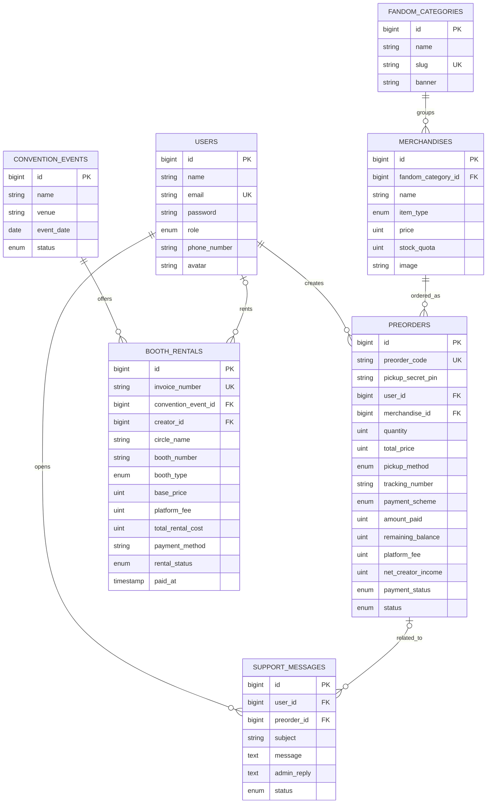
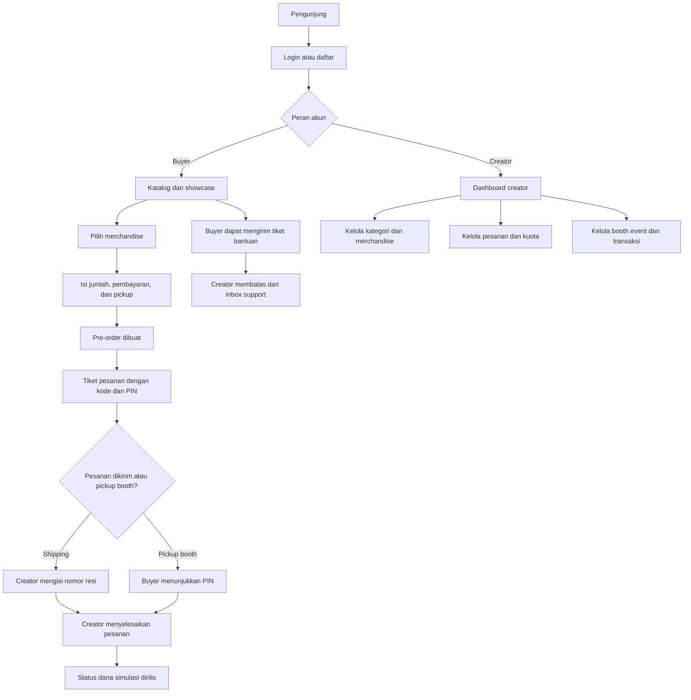

# ComiCraft

ComiCraft adalah aplikasi web untuk katalog merchandise fanart, pre-order, dukungan pelanggan, dan pengelolaan booth kreator pada event konvensi.

## Dokumentasi

Dokumentasi proyek tersedia sebagai file terpisah di [`docs/`](docs/), dan ringkasan utamanya juga ditampilkan di README ini.

| Dokumen | Isi |
| --- | --- |
| [ERD](docs/erd.md) | Entitas, atribut penting, dan relasi database |
| [Flow aplikasi](docs/flow.md) | Alur buyer, creator, pre-order, dan booth |
| [Roles](docs/roles.md) | Hak akses buyer dan creator |
| [Struktur proyek](docs/structure.md) | Lokasi kode utama dan tanggung jawabnya |
| [Troubleshooting](docs/troubleshooting.md) | Masalah umum saat development dan deployment |

## Fitur utama

- Autentikasi dan redirect berdasarkan peran pengguna.
- Katalog merchandise berdasarkan fandom dan showcase karakter.
- Pre-order dengan kuota produksi, pilihan pembayaran penuh atau DP, metode pengambilan, dan PIN serah-terima.
- Dashboard creator untuk merchandise, pesanan, tiket bantuan, booth event, serta transaksi.
- Penyimpanan gambar merchandise dapat menggunakan Supabase Storage; konfigurasi default development tetap memakai disk lokal.

## ERD



`image`, `avatar`, dan `banner` menyimpan path atau URL file, bukan isi biner gambar. Database queue/cache (`jobs`, `failed_jobs`, `cache`, dan `sessions`) merupakan tabel infrastruktur Laravel dan tidak ditampilkan dalam ERD domain.

## Flow aplikasi



> **Catatan pembayaran:** status escrow dan pembayaran pada aplikasi adalah simulasi untuk demonstrasi. Belum ada payment gateway yang memproses uang sungguhan.

## Roles dan akses

| Peran | Akses utama |
| --- | --- |
| Guest | Beranda, login, dan registrasi |
| Buyer | Katalog, showcase, profil, pre-order milik sendiri, pesanan sendiri, dan tiket bantuan |
| Creator | Semua akses buyer serta dashboard, CRUD merchandise/kategori, manajemen pesanan, balasan support, booking booth, dan transaksi |

Route buyer memerlukan autentikasi. Route dashboard menggunakan middleware `role:creator`; buyer yang mencoba mengaksesnya akan ditolak dengan HTTP 403. Detailnya ada di [docs/roles.md](docs/roles.md).

## Akun uji coba

Akun berikut disediakan oleh `DatabaseSeeder` untuk **demonstrasi lokal/tugas**:

| Peran | Email | Password |
| --- | --- | --- |
| Creator | `creator@comicraft.test` | `password123` |
| Buyer | `nadeshiko@gmail.com` | `password123` |

Untuk database development yang masih kosong, jalankan:

```bash
php artisan migrate:fresh --seed
```

> Perintah tersebut menghapus seluruh tabel dan data database aktif sebelum membuat ulang data. Jangan gunakan pada database deployment yang berisi data yang ingin dipertahankan. Untuk database yang sudah ada, buat/ubah akun demo secara aman melalui dashboard/admin atau prosedur database yang sesuai—jangan mengandalkan menjalankan seeder berulang kali.

Kredensial ini bersifat publik untuk tugas/demo. Jangan gunakan password tersebut untuk akun atau deployment publik; ganti atau hapus akun demo sebelum aplikasi dibuka untuk umum.

## Menjalankan secara lokal

Persyaratan dasar: PHP `^8.3`, Composer, Node.js/npm, dan database yang didukung konfigurasi Laravel.

```bash
composer install
Copy-Item .env.example .env
php artisan key:generate
php artisan migrate:fresh --seed
npm install
npm run build
composer run dev
```

Di PowerShell Windows, `Copy-Item` menyalin `.env.example` menjadi `.env`. Sesuaikan koneksi database di `.env` sebelum migrasi bila tidak menggunakan default proyek. `migrate:fresh` menghapus tabel aplikasi, jadi gunakan hanya untuk database development yang boleh di-reset.

## Supabase Storage untuk gambar merchandise

Proyek mendukung disk `supabase` khusus gambar merchandise. Avatar tetap memakai disk `public` lokal. Untuk memakai Supabase:

1. Buat bucket Supabase Storage dan atur **Public** jika gambar katalog harus dapat dilihat tanpa login.
2. Salin endpoint, region, dan S3 access keys dari halaman **Storage → Settings → S3 Connection**.
3. Simpan nilai berikut sebagai environment variables/secrets pada hosting (jangan commit nilai rahasia):

   ```text
   MERCHANDISE_DISK=supabase
   SUPABASE_S3_ACCESS_KEY_ID=
   SUPABASE_S3_SECRET_ACCESS_KEY=
   SUPABASE_S3_REGION=
   SUPABASE_S3_BUCKET=
   SUPABASE_S3_ENDPOINT=
   SUPABASE_STORAGE_PUBLIC_URL=
   ```

4. `SUPABASE_STORAGE_PUBLIC_URL` adalah URL dasar bucket publik, dengan format `https://<project-ref>.supabase.co/storage/v1/object/public/<bucket>`.
5. Redeploy aplikasi dan upload ulang file lama yang belum ada di bucket.

Template nama variabel juga tersedia di [.env.example](.env.example). Jangan masukkan access key atau secret ke repository, README, atau frontend.

## Struktur utama

```text
app/
  Http/Controllers/     Controller buyer, auth, profile, dan creator
  Http/Middleware/      Middleware role
  Models/               Model Eloquent dan relasi
config/                 Konfigurasi aplikasi, database, dan filesystem
database/
  migrations/           Skema database
  seeders/              Data demo
resources/views/        Blade views buyer, creator, auth, dan komponen
routes/web.php          Route aplikasi
tests/Feature/          Tes fitur dan alur HTTP
docs/                   Dokumentasi teknis proyek
```

## Testing

```bash
php artisan test --compact
```

Tes menggunakan PHPUnit. Lihat [docs/troubleshooting.md](docs/troubleshooting.md) untuk catatan pemecahan masalah. Untuk susunan file yang lebih lengkap, lihat [docs/structure.md](docs/structure.md).

## Lisensi

Proyek ini menggunakan kerangka Laravel. Lisensi dan atribusi komponen pihak ketiga mengikuti lisensi masing-masing dependency yang tercantum di Composer/npm.
