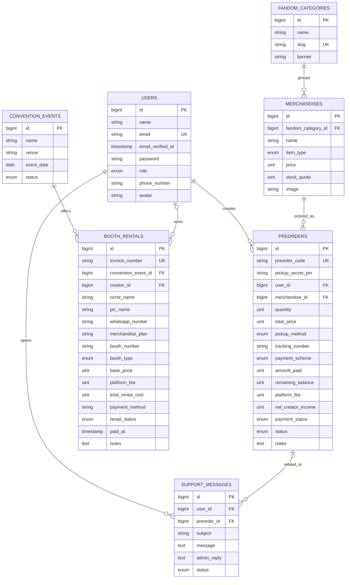

# ERD ComiCraft

Diagram menggambarkan tabel domain yang dibuat oleh migration proyek. Field timestamp standar (`created_at`, `updated_at`) tidak ditampilkan agar diagram tetap ringkas.

## Relasi

| Relasi | Makna |
| --- | --- |
| `fandom_categories` 1 — N `merchandises` | Satu kategori memiliki banyak produk; menghapus kategori menghapus produk terkait (`cascadeOnDelete`). |
| `users` 1 — N `preorders` | Buyer dapat membuat banyak pesanan; akun yang dihapus akan menghapus pesanannya (`cascadeOnDelete`). |
| `merchandises` 1 — N `preorders` | Produk dapat muncul di banyak pesanan; penghapusan produk menghapus pesanan terkait (`cascadeOnDelete`). |
| `users` 1 — N `support_messages` | Buyer dapat membuat banyak tiket; tiket terhapus jika pemilik akun dihapus. |
| `preorders` 0..1 — N `support_messages` | Tiket dapat tidak terkait pesanan; penghapusan pesanan mengosongkan `preorder_id` (`nullOnDelete`). |
| `convention_events` 1 — N `booth_rentals` | Event memiliki daftar booth; penghapusan event menghapus booth terkait. |
| `users` 0..1 — N `booth_rentals` | Booth bisa tersedia tanpa creator; penghapusan akun mengosongkan `creator_id`. |

`image`, `avatar`, dan `banner` adalah path/URL ke file storage, bukan kolom biner gambar. Tabel bawaan Laravel untuk cache, job, session, dan reset password tidak ditampilkan.
